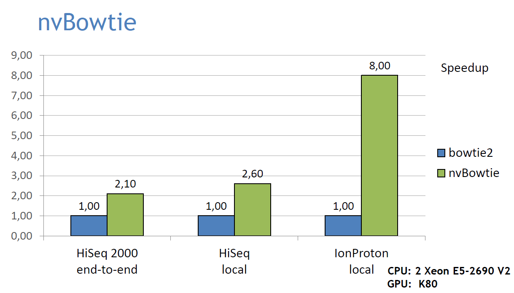

```{r setup, include=FALSE}
# Building this package needs no GPU, but every example below runs nvBowtie /
# nvBWT / nvbio_tests, which do. On a build-only host (r-universe, CI runner,
# cluster login node, container) or on a shared builder whose GPU is already
# fully allocated by another job, those calls cannot work: skip the GPU chunks
# instead of failing the whole build. The floor is the one the Rd examples of
# nvBWT()/nvBowtie() use, so the vignette and the examples agree; it can be
# raised with options(RbowtieCuda.minFreeMemMB = ...).
GPU_FREE_MB <- RbowtieCuda:::gpu_min_free_mb("light")
can_use_gpu <- isTRUE(RbowtieCuda:::has_gpu(min_free_mb = GPU_FREE_MB))
knitr::opts_chunk$set(echo = TRUE)
```

## Introduction

NVBIO is a library of reusable components developed by NVIDIA Corporation to accelerate bioinformatics applications using CUDA technology. Although specifically designed to harness the computational power of NVIDIA GPUs, many of its components are fully cross-platform and can be used in both host C++ and device CUDA code.

The purpose of NVBIO is twofold. It serves as a robust foundation for developing modern GPU-focused applications, ensuring that core computations delegated to the library automatically benefit from advances in GPU technology. At the same time, it provides valuable resources for designing novel bioinformatics algorithms tailored to massively parallel architectures.

In addition to its core components, NVBIO includes a suite of applications built on top of the library. Among these is nvBowtie, a re-engineered implementation of the widely recognized Bowtie2 short-read aligner ^[Langmead, B., & Salzberg, S. L. (2012). Fast gapped-read alignment with Bowtie 2. Nature methods, 9(4), 357-359.]. Unlike many prototypes, nvBowtie is built as an industrial-grade aligner, replicating most of Bowtie2’s original features while adding enhancements such as efficient support for direct BAM output, with future plans for CRAM support.

## Performances

nvBowtie is designed to fully exploit the massive parallelism of modern GPUs, delivering significantly higher alignment throughput without compromising accuracy, or achieving even greater accuracy in the same amount of time. For example, its performance was compared to Bowtie2 using an Illumina HiSeq 2000 dataset (the first 10 million reads of ERR161544) and an IonProton dataset, applying both end-to-end and local alignment methods. The results demonstrate an impressive 99.98% agreement at high MAPQ scores. For comparison, Bowtie2 tests were performed using 20 CPU threads with default alignment settings.

```{r fig.cap="benchmark", fig.alt = "benchmark.", eval = TRUE}

```


### RBowtieCuda

This package provides an R wrapper for [nvBio/nvBowtie](https://github.com/NVlabs/nvbio), offering user-friendly interfaces specifically designed for R users. To maximize efficiency, the indexing and alignment functions (nvBWT and nvBowtie) are implemented in C++ and seamlessly integrated into R using the system2 function. This integration is fully transparent to the user, ensuring that the package is easy to use while providing high-performance features optimized to take full advantage of your machine's capabilities.

Additionally, an experimental implementation of the `Wavefront Alignment (WFA)` method ^[Marco-Sola S, Moure JC, Moreto M et al. Fast gap-affine pairwise alignment using the wavefront algorithm. Bioinformatics 2021;37: 456–63.] is included and can be accessed by using the ```--wfa``` parameter during execution.

Please note that this package requires an NVIDIA graphics card for proper functionality.


## Additional Installation Instructions

For detailed installation steps, please refer to the INSTALL file included with the package.

RbowtieCuda is compatible with all Cuda versions greater than or equal to 10. A minimum of 16 GB of RAM is recommended for compiling the package.

## An Example Workflow Using RbowtieCuda

### Installation

To install the latest version of RbowtieCuda, ensure that you are running the most up-to-date version of R. As RbowtieCuda is part of the Bioconductor project, you can easily install it along with its dependencies by following these steps:

```
library(BiocManager)
BiocManager::install("RbowtieCuda")
```

As with any other R package, you need to load RbowtieCuda each time before using it, like this:

```{r loading, eval = TRUE}
library(RbowtieCuda)
```

```{r gpu-availability, eval = TRUE, echo = FALSE}
if (!can_use_gpu) {
  cat(
    "\n**Note:** no usable NVIDIA GPU was detected on the machine that built\n",
    "this document (or the GPU present has less than ", GPU_FREE_MB,
    " MB of free device memory).\n",
    "Building and checking RbowtieCuda does not require a GPU, but the\n",
    "examples below do, so their code is shown without being evaluated.\n",
    "Run them on a machine with a GPU to see the output.\n",
    sep = ""
  )
}
```

### nvBWT : Building BWT Indices for Reference FASTA Files

nvBWT is an application developed as part of the NVBIO library, designed to perform BWT-based reference indexing for nvBowtie and potentially other FM-index-based applications. When provided with one or more FASTA files, nvBWT generates both the forward and reverse Burrows-Wheeler Transform (BWT), along with a 2-bit packed representation of the sequences. In addition, it produces several auxiliary indices to support efficient alignment and querying.

#### Example:

```{r idad, eval = can_use_gpu}
td <- tempdir()
fa_file <- system.file(package="RbowtieCuda", "extdata", "bt2", "refs", "lambda_virus.fa")
nvBWT(myinput=fa_file, output=file.path(td, "index"), options="")
```

will generate the following files:

```
index.pac
index.rpac
index.bwt
index.rbwt
index.sa
index.rsa
index.ann
index.amb
```

Warning: if you run the command in a directory that already contains these files, they will be deleted and new files will be generated.

nvBWT supports the following command options:
```
-v       | --verbosity     int (0-6) [5]     // select the verbosity level
-m       | --max-length    int       [inf]   // clamp input length
-b       | --byte-packing                    // output a byte-encoded .pac file
-w       | --word-packing                    // output a word-encoded .wpac file (more efficient)
-c       | --crc                             // compute CRCs
-d       | --device                          // select a cuda device
```

### nvBowtie Alignments:

nvBowtie is a GPU-accelerated re-engineering of Bowtie2, one of the most widely used short-read aligners. Completely rewritten from scratch, nvBowtie retains many of the key features of Bowtie2, though not all functionalities are replicated.

Designed to fully exploit the massive parallelism of modern GPUs, nvBowtie achieves significantly higher alignment throughput without sacrificing accuracy—or offers even greater accuracy within the same time frame. Despite its focus on performance, nvBowtie is carefully designed to align closely with Bowtie2 in terms of specificity and sensitivity, maintaining the same level of reliability for users.

To harness the computational power of modern processor architectures, nvBowtie re-implements the algorithms underlying Bowtie2 but adopts a fundamentally different approach. While Bowtie2 is optimized to process one read at a time—using multiple CPU threads to handle different reads simultaneously—nvBowtie operates on large batches of reads, treating their alignment as a pipeline. This pipeline consists of many relatively simple but highly parallel stages, each optimized for execution on GPUs. In several stages, the parallelism extends far beyond the read level, processing multiple candidate hits for each read simultaneously, enabling a much finer granularity of parallel computation.

#### New features :

We’ve introduced several new functions to nvBowtie. You can now perform alignments using the WFA method by including the ```--wfa  (or --scoring wfa)``` parameter. The WFA method requires a large amount of RAM on the graphics card. We therefore recommend using an Nvidia card with 8GB or more. Please note that this feature is still experimental; it currently supports only end-to-end alignments and does not yet allow customization of scoring parameters. By default, it uses the following scoring:  match:0, mismatch:1, gap_open:1 and gap_ext:1.

Additionally, the ```--cache-writes``` parameter activates the asynchronous SAM writer for single-end alignments: output records are formatted and written by a background thread while the GPU aligns the next batches, giving a large speedup on sizeable outputs (about 100 MB of extra host RAM are used by the queue). It is not recommended for paired-end alignments and is ignored for BAM output. Pair it with ```--batch-size 64```: ```--batch-size``` caps the number of reads per batch, in thousands of reads (minimum 16, default 1024); smaller batches overlap the alignment and the writing much better than the default.

#### Example :

Reads_1 and Reads_2 represent raw paired-end read files in FASTQ format. Using a nvBWT index, these reads are mapped to the reference genome by invoking nvBowtie. The resulting alignments are stored in a BAM file, with its file path specified by the output parameter.

```{r bt2bd1, eval = can_use_gpu}
read_1 <- system.file(package="RbowtieCuda", "extdata", "bt2", "reads", "reads_1.fastq")
read_2 <- system.file(package="RbowtieCuda", "extdata", "bt2", "reads", "reads_2.fastq")
nvBowtie(file.path(td, "index"), file.path(td, "my_result.bam"), options="", seq1=read_1, seq2=read_2)
```

#### Indexing of bam files produced by nvBowtie

nvBowtie does not automatically generate the .bai index files that are typically associated with .bam files.

These index files are essential for visualizing .bam files in tools such as the Integrative Genomics Viewer (IGV).

Fortunately, this issue can be easily resolved using the Rsamtools package, which includes the required functionality. For example, if you have generated a file named results.bam, you can create the corresponding index file with a simple command.

You only need to run the following in R:

```
library(Rsamtools) 
sortBam("results.bam", "results")
indexBam("results.bam")
```

#### 

#### Options and Version of the nvBowtie Aligner

You can customize the alignment process by adjusting the available options, enabling you to optimize performance and accuracy according to your specific needs:

```{r bt2usage, eval = TRUE}
nvBowtie_usage()
```

You can execute unit tests for the program using the following commands or tools, ensuring its functionality and correctness:

```{r bt2tests, eval = can_use_gpu}
nvbio_tests()
```

And you can obtain version information by executing the following command:

```{r bt2version, eval = TRUE}
nvBowtie_version()
```

## Session Information

```{r sessioninfo, eval = TRUE}
sessionInfo()
```


## Acknowledgement

We would like to thank Ismael Galve Roperh for his assistance.

Dedicated to the memory of Lilit Tabirian.

## News

* 2026-11-17
  RbowtieCuda version 1.5.7

  - nvbio (host banded affine alignment): the score reported for a banded wavefront window is now the cost of the alignment that is actually emitted. The banded engines credit a cell with the wavefront it was reached on, and where the rows run out the traceback completes a tail up to that credit -- a tail the wavefront never proved. Base by base, the emitted path then costs one gap-open (or one mismatch) more than the number advertised. Measured on the 20 real windows of    nvbio-test: the 13 whose longest gap run is a single symbol were exact, and all 7 with a run of two symbols or more costed more than they advertised, always in that direction. On the host the    window is now answered by the affine banded DP under the aligner's own penalties, and both the score call and the traceback report the cost of the path the traceback emits, so a report that    no alignment earns cannot pass. Device code is untouched, and keeps the per-window budgets the GPU needs.
  - Known, still open upstream: the same defect sits in the direction encoding of the shared banded Gotoh traceback (a direction-continuation bit is stored on the cell next to the one it describes), so the device traceback and nvBowtie in banded Gotoh mode keep the one-event under-credit; only the host path is repaired here.
  - Affine gap convention made explicit: a WFA engine charges a gap of L symbols as gap_open + L * gap_extension, where the nvbio DP family charges gap_open + (L-1) * gap_extension. The WfahScoreScheme adaptor bridges the two (gap_open_dp = gap_open + gap_extension); without it the banded DP and the wavefront disagreed by one extension per gap.
  - nvbio-test: the banded WFA cases are self-checking. Each site now carries the expected score as   well as the expected CIGAR, and the test compares the score, the CIGAR and the cost of the emitted path. 12 of the 15 banded sites moved to the score the banded semantics really produces -- a start free along the text, anchored at the end of the pattern, the end of the text swept over the last row of the pattern -- where the window anchored at both of its ends is kept by the corresponding full-length WFA case.
  - Banded kernels: a prefetch no longer reads past the bound of its row in the banded Smith-Waterman and WFA kernels, and a window is no longer accepted when the text is shorter than the pattern.


* 2026-11-02
  RbowtieCuda version 1.4.5

  - nvBowtie: single-end SAM output is now produced by a dedicated background writer thread fed by a small ring buffer, so record formatting and disk writes overlap the GPU alignment of the next    batches. Selected with --cache-writes (single-end SAM output). Combined with --batch-size 64 it divided the wall time of a 1M-read benchmark by about 3.7 (4.96 s -> 1.34 s on 1M x 10 bp reads   against a 46 Mbp chromosome); 
  --batch-size caps the reads per batch in thousands (min 16,    default 1024) and is now documented in nvBowtie_usage().
  - nvBowtie: much faster SAM record emission: the writer is buffered and hands a whole block of records to the disk with a single fwrite, instead of ~30 stdio calls per record.
  - nvBowtie: WFA alignment (--wfa / --scoring wfa) is faster thanks to improved wavefront kernels, and its admissible-score cutoff now follows --max-dist: raising --max-dist in WFA mode    now maps more reads, as it already did in edit-distance mode.
  - nvBowtie: fixed a paired-end crash (cudaErrorInvalidValue during a host-to-device copy)introduced by the page-locked host buffers of version 1.4.4: page-lock registrations are now size-aware, so host buffers that grow are re-registered over their full span.
  - The --cache-writes option is not recommended for paired-end alignments (the legacy path is kept) and is ignored for BAM output, with a warning; it costs a small ring buffer (~100 MB).
    The nvBowtie() wrapper now strips the flag itself in those two cases: a warning is issued for paired-end, a message for BAM output; single-end SAM output keeps the flag and its queue mode.


* 2026-10-07
  RbowtieCuda version 1.4.4

  - nvBowtie: faster paired-end opposite-mate scoring using a Myers bit-vector core, enabled by default; use --opposite-myers 0 to restore the previous algorithm. Alignment output is unchanged (bit-identical SAM records); the scoring stage is ~1.7x faster on GPU.
  - CUDA architectures are auto-detected at build time (native code for the installed GPUs, with a PTX fallback), replacing the previously hard-coded target.
  - Faster host/GPU transfers through page-locked buffers and stream-scoped synchronisation.
  - Faster BWT occurrence-table construction on CPU.

  
* 2026-05-08
  RbowtieCuda version 1.4.3

  - Fix for an issue with the Thrust library

* 2026-04-10
  RbowtieCuda version 1.0.11

  - Installation modifications


* 2025-10-12
  RbowtieCuda version 1.0.10
  - Installation modifications


* 2025-09-25
  RbowtieCuda version 1.0.9
  - nvBowtie, nvBWT and nvbio_test propagate their error messages to the R interface
  - Improved diagnostic messages during package installation
  - Improved program stability
  - Faster startup
  - Compatible with CUDA 13.0
  - The program needs 16 GB of RAM to be compiled (with Sys.setenv(MAKEFLAGS="-j8"))


* 2025-04-17
  RbowtieCuda version 1.0.1

  - The package is available on Bioconductor


## Credits

The main contributors of the original NVBIO are:

    Jacopo Pantaleoni - jpantaleoni@nvidia.com
    Nuno Subtil - nsubtil@nvidia.com

RbowtieCuda developers:

    Samuel Simon Sanchez - samsimon@ucm.es
    Franck RICHARD - franck.richard@winstars.net

The maintainer of the RbowtieCuda package is [Franck RICHARD](mailto:franck.richard@winstars.net)


## Website

A dedicated website with helpful resources for the RbowtieCuda package is available [here](https://belacqua-labo.ovh/bioinformatic/RbowtieCuda), and a github copy [here](https://github.com/FranckRICHARD01/RbowtieCuda)


## References

[1] Langmead, B., & Salzberg, S. L. (2012). Fast gapped-read alignment with Bowtie 2. Nature methods, 9(4), 357-359.

[2] Marco-Sola S, Moure JC, Moreto M et al. Fast gap-affine pairwise alignment using the wavefront algorithm. Bioinformatics 2021;37: 456–63.